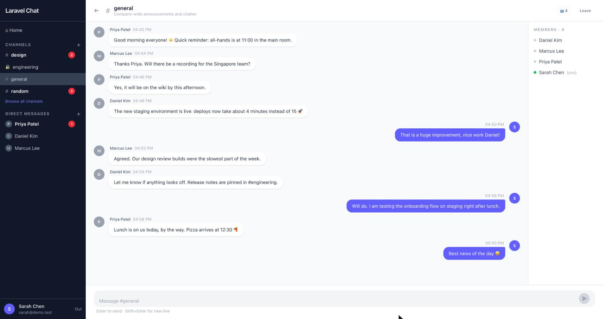
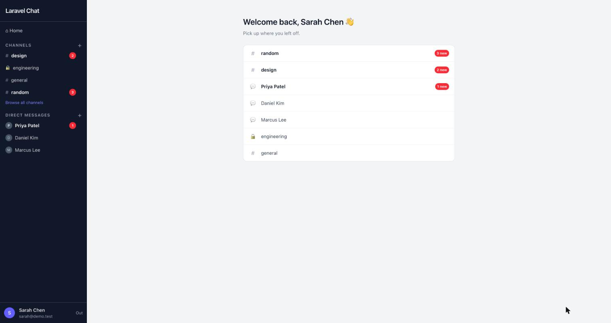
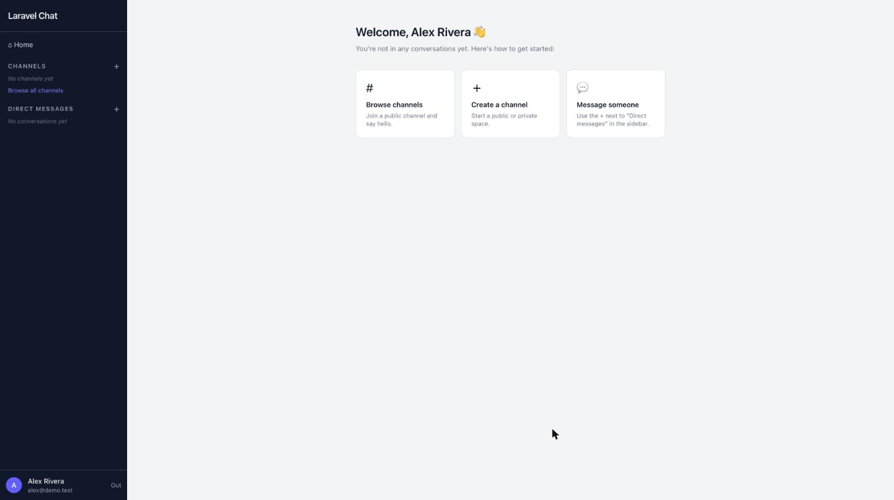
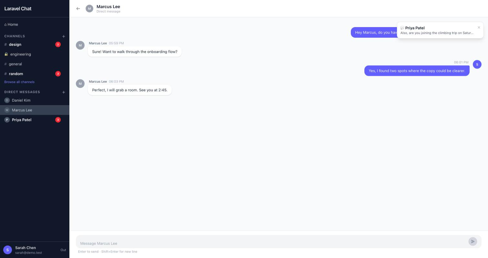
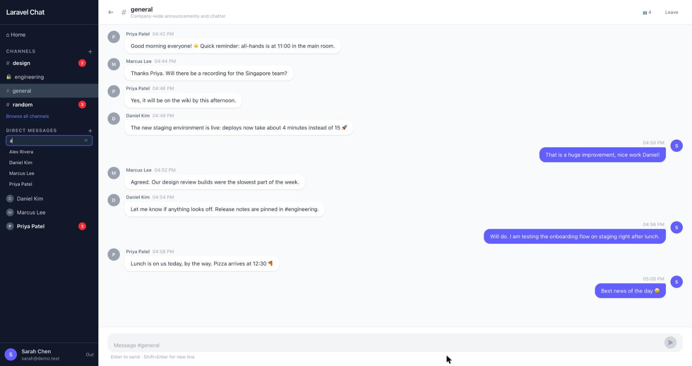
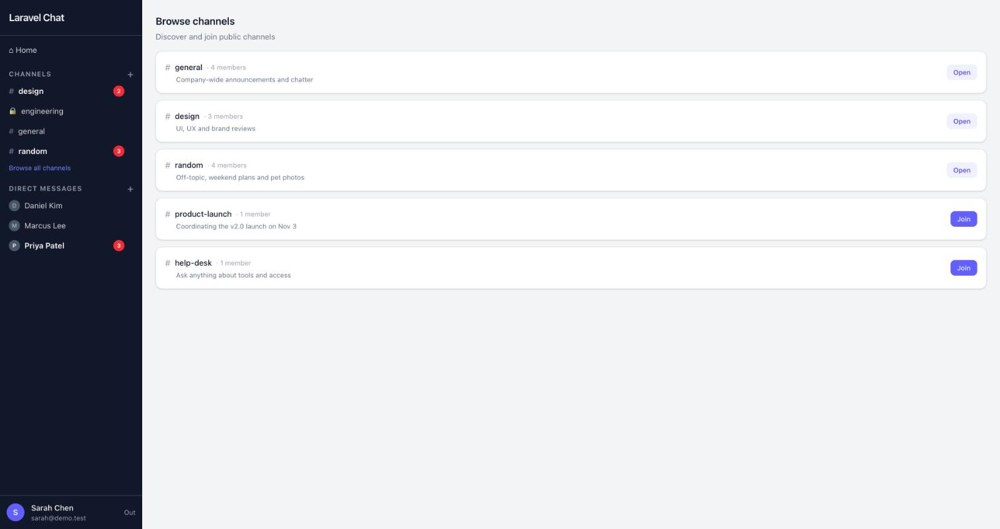
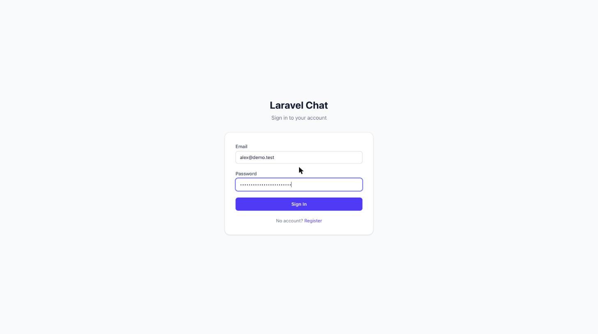

# Laravel Real-Time Chat

> A real-time group chat system built to demonstrate senior-level Laravel architecture — clean domain separation, repository pattern, event-driven broadcasting, and strict TDD discipline.



---

## Screenshots

| | |
|---|---|
| **Home: returning user**<br>Conversations with something new come first; red badges show unread counts. | **Home: new user**<br>Getting-started options when you haven't joined anything yet. |
|  |  |
| **Direct messages and live alerts**<br>A message from someone else pops up wherever you are and bumps their badge. | **Starting a direct message**<br>Search people by name from the sidebar (names only, never emails). |
|  |  |
| **Browse channels**<br>Join public channels or open ones you're already in. | **Sign in** |
|  |  |

---

## Why This Exists

Most Laravel tutorials show you the happy path: fat controllers, raw Eloquent calls everywhere, no tests. This project is the antidote. It is a reference implementation of how a production chat system should be structured:

- Business logic lives in **services**, not controllers
- Data access is abstracted behind **repository interfaces** — the database is a detail, not the foundation
- Every feature is **tested before it is written** (TDD, no exceptions)
- Real-time events are modeled as explicit **domain events**, not ad-hoc socket emissions
- The system is designed to **scale horizontally** from day one via Redis-backed broadcasting

---

## Architecture Diagram

```
Browser
  │
  │  HTTP (Inertia/Vue)          WebSocket (Reverb)
  ▼                                    ▼
Nginx :80 ────────────────── Reverb Server :8080
  │                                    │
  ▼                          Presence Channel
PHP-FPM (app)                channel.{channel_id}
  │
  ├── routes/web.php
  │     └── Controllers  ← thin, validate → delegate → respond
  │           └── Services  ← orchestrate everything
  │                 ├── Repositories ──── MySQL (via Eloquent)
  │                 └── Events ─────────→ Redis (queue)
  │                                           │
  │                                    Queue Worker
  │                                           │
  │                               Reverb (Redis subscriber)
  │                                           │
  └── routes/channels.php ◄────── WS auth ───┘
        └── Presence auth via ChannelRepository
```

**Request lifecycle (send a message):**

1. `POST /channels/{channel}/messages` hits Nginx → PHP-FPM
2. `SendMessageRequest` validates content is non-empty
3. `MessageController` delegates to `MessageService::send()`
4. `MessageService` checks membership via `ChannelRepository::isMember()`
5. `MessageRepository::create()` persists the row
6. `MessageSent` event is dispatched → pushed to Redis queue
7. Queue worker picks it up → hands to Reverb broadcaster
8. Reverb pushes the payload to all presence channel subscribers instantly

---

## Tech Stack & Decisions

| Layer | Technology | Why |
|-------|-----------|-----|
| Backend | Laravel 13 / PHP 8.4 | Modern PHP, first-party WebSocket support |
| WebSockets | Laravel Reverb | Self-hosted, Redis-backed, no third-party cost |
| Frontend | Inertia.js + Vue 3 | SPA feel without maintaining a separate API |
| Styling | Tailwind CSS 4 | Utility-first, zero unused CSS in production |
| Queue & cache | Redis 7 | Unified driver for queues, sessions, and broadcast scaling |
| Database | MySQL 8 | Relational integrity; composite indexes on hot queries |
| Testing | PHPUnit 13 + ParaTest | Full parallel test suite, zero mocks of the real database |
| Code style | Laravel Pint (PSR-12) | Enforced in CI — no style debates |
| Runtime | Docker Compose (7 services) | Exact parity between dev, CI, and production |

**Why Reverb over Pusher?**
Reverb is self-hosted. No per-message cost, no vendor lock-in, and it uses the same Laravel Echo API. For scaling it integrates with Redis pub/sub, so running multiple Reverb nodes is a config flag, not an architectural change.

**Why repository pattern over direct Eloquent in services?**
Services depend on interfaces, not implementations. Unit tests swap the real repository for an in-memory fake without touching a database. If you ever move to a NoSQL store or a read replica, you replace one class, not a dozen service methods.

---

## Domain Structure

```
app/
├── Domains/
│   └── Chat/                        ← pure domain — no HTTP, no Eloquent internals
│       ├── Models/
│       │   ├── Channel.php           — entity: type (public|private), slug, membership helpers
│       │   └── Message.php           — entity: content, read_at, sender/channel relations
│       ├── Repositories/             ← interfaces only — the "what", not the "how"
│       │   ├── ChannelRepositoryInterface.php
│       │   └── MessageRepositoryInterface.php
│       ├── Services/                 ← use-case orchestrators
│       │   ├── ChannelService.php    — create, list, join, leave
│       │   └── MessageService.php    — send, history
│       └── Events/
│           └── MessageSent.php       — broadcastable domain event
│
├── Infrastructure/
│   └── Repositories/                ← Eloquent implementations, bound at boot
│       ├── ChannelRepository.php
│       └── MessageRepository.php
│
├── Http/
│   ├── Controllers/
│   │   ├── Auth/AuthController.php
│   │   ├── Chat/ChannelController.php
│   │   └── Chat/MessageController.php
│   ├── Requests/
│   │   ├── Auth/LoginRequest.php
│   │   ├── Auth/RegisterRequest.php
│   │   └── Chat/CreateChannelRequest.php
│   └── Middleware/HandleInertiaRequests.php   — shares auth user + flash to all Inertia pages
│
└── Providers/
    ├── AppServiceProvider.php
    └── RepositoryServiceProvider.php   — binds interfaces → implementations
```

---

## Services

Services are the center of gravity. They coordinate repositories, authorization checks, and event dispatch. Controllers call services; services call repositories. Neither direction is ever reversed.

### `ChannelService`

| Method | What it does |
|--------|-------------|
| `create(User, string $name, string $type, ?string $description)` | Creates the channel, auto-adds creator as first member |
| `listPublic(int $perPage)` | Returns paginated public channels |
| `listForUser(User, int $perPage)` | Returns public/private channels the user has joined (direct messages excluded) |
| `join(Channel, User)` | Adds user to a public channel; throws `AuthorizationException` for private channels |
| `leave(Channel, User)` | Removes user from channel |
| `invite(Channel, User $inviter, User $invitee)` | Adds a user to the channel (the only way into a private one); throws `AuthorizationException` if the inviter is not a member or the channel is a direct message |
| `close(Channel, User)` | The sidebar "X": leaves a channel; for a direct message, hides it and clears its history **for that user only** (it reopens when a new message arrives) |
| `members(Channel)` | Members (id, name) ordered by name |

### `DirectMessageService`

A direct message is a channel of type `direct` with exactly two members, no name, and a unique `direct_key` (`"{lowerUserId}:{higherUserId}"`) so each pair of users has one conversation.

| Method | What it does |
|--------|-------------|
| `start(User $from, User $to)` | Finds or creates the pair's conversation and (re-)adds both members; throws `InvalidArgumentException` for yourself |
| `listForUser(User)` | The user's visible conversations, each with the other person as `partner` |
| `partnerOf(Channel, User)` | The other person in a conversation |

### `SidebarService`

`for(User)` builds the sidebar shared with every page (Inertia prop `sidebar`): joined channels and direct messages, each with an `unread` count.

### `MessageService`

| Method | What it does |
|--------|-------------|
| `send(Channel, User $sender, string $content)` | Verifies sender is member, persists message, marks it read for the sender, reopens a closed direct message, broadcasts `MessageSent` and `ChannelActivity`, returns message with sender loaded |
| `getMessages(Channel, User $member, int $perPage)` | Returns the member's paginated history (minus anything they cleared): page 1 is the newest messages, each page ordered oldest-first |
| `markRead(Channel, User)` | Marks everything in the channel as read for the member |

---

## Events & Broadcasting

### `MessageSent`

Dispatched by `MessageService::send()` on every new message, for whoever has the conversation open.

```php
class MessageSent implements ShouldBroadcast
{
    // Broadcasts on the presence channel for the room
    public function broadcastOn(): array
    {
        return [new PresenceChannel('channel.' . $this->message->channel_id)];
    }

    // Event name the frontend listens for: .message.sent
    public function broadcastAs(): string
    {
        return 'message.sent';
    }

    // Payload sent to all subscribers
    public function broadcastWith(): array
    {
        return [
            'id'         => $this->message->id,
            'content'    => $this->message->content,
            'created_at' => $this->message->created_at->toISOString(),
            'sender'     => [
                'id'   => $this->message->sender->id,
                'name' => $this->message->sender->name,
            ],
        ];
    }
}
```

### `ChannelActivity`

Also dispatched by `MessageService::send()`, once, on the **personal channel of every other member** (`App.Models.User.{id}`), as `.channel.activity` with `channel_id`, `channel_type`, `channel_name`, `message_id`, a 100-character `preview` and the `sender`. The layout uses it wherever the user is: it bumps the sidebar's red unread badge, adds a new direct-message conversation to the sidebar, and shows a pop-up alert for direct messages.

Unread state lives on the `channel_user` pivot as `last_read_message_id` (message ids, not timestamps, so it is exact). Opening a conversation marks it read; the open page also calls `POST /channels/{channel}/read` when a live message arrives.

**Channel naming conventions:**

| Channel | Type | Current use |
|---------|------|-------------|
| `channel.{id}` | Presence | Chat room or direct message — messages + who's online |
| `App.Models.User.{id}` | Private | Per-user activity: unread badges and direct-message alerts |

---

## Policies

Authorization for channel actions is enforced directly in services rather than in a separate Policy class. This keeps the authorization rule co-located with the business logic that requires it.

| Rule | Enforced in | Mechanism |
|------|------------|-----------|
| Only members can send messages | `MessageService::send()` | Checks `ChannelRepository::isMember()`, throws `AuthorizationException` |
| Only public channels can be joined freely | `ChannelService::join()` | Checks `Channel::isPublic()`, throws `AuthorizationException` |
| Only members can view a channel | `ChannelController::show()` | Checks `ChannelRepository::isMember()`, aborts 403 |
| Only members can read a channel's message history | `MessageController::index()` | Checks `ChannelRepository::isMember()`, aborts 403 |
| Only members can invite others | `ChannelService::invite()` | Checks `ChannelRepository::isMember()`, throws `AuthorizationException` |
| Nobody can be invited into a direct message | `ChannelService::invite()` | Checks `Channel::isDirect()`, throws `AuthorizationException` |
| You cannot message yourself | `StartDirectMessageRequest` | `not_in` rule on `user_id`, 422 |
| People search returns names only | `UserRepository::search()` | Selects `id`, `name`; email only matches exactly, never returned |

A dedicated `ChannelPolicy` is the natural next step if the authorization matrix grows (e.g. admin roles, channel moderation).

---

## Broadcasting Classes

### `MessageSent`

Full path: `app/Domains/Chat/Events/MessageSent.php`

Implements `ShouldBroadcast`. Uses `broadcast()->toOthers()` in `MessageService` so the sender does not receive their own echo — they already applied the message optimistically in the UI.

### Channel Authorization (`routes/channels.php`)

```php
// User-specific private channel
Broadcast::channel('App.Models.User.{id}', function ($user, $id) {
    return (int) $user->id === (int) $id;
});

// Presence channel for a chat room
Broadcast::channel('channel.{channelId}', function ($user, $channelId) {
    $channel = app(ChannelRepositoryInterface::class)->findById($channelId);
    if (! $channel) return false;

    $isMember = app(ChannelRepositoryInterface::class)->isMember($channel, $user);
    return $isMember ? ['id' => $user->id, 'name' => $user->name] : false;
});
```

The presence channel returns an array on success. Laravel broadcasts this payload to all members so the UI can maintain a live online-users list.

---

## Reverb

Reverb is the WebSocket server. It runs as a dedicated container and communicates with the PHP application exclusively through Redis.

**How messages flow:**

```
MessageSent dispatched
       │
       ▼ (implements ShouldBroadcast)
  Redis Queue  ──►  Queue Worker
                         │
                    Reverb Broadcaster
                         │
                    Redis pub/sub
                         │
                    Reverb Server
                         │
                    WebSocket clients
```

**Reverb server is started with:**
```bash
php artisan reverb:start --host=0.0.0.0 --port=8080
```

**Frontend subscribes via Laravel Echo:**
```js
Echo.join(`channel.${channelId}`)
    .here((users) => setOnlineUsers(users))
    .joining((user) => addOnlineUser(user))
    .leaving((user) => removeOnlineUser(user))
    .listen('.message.sent', (e) => appendMessage(e));
```

**Key env variables:**
```env
BROADCAST_CONNECTION=reverb
REVERB_APP_KEY=chat-key
REVERB_APP_SECRET=chat-secret
REVERB_APP_ID=chat-app
REVERB_HOST=reverb         # service name in Docker
REVERB_PORT=8080
```

---

## Scaling Considerations

### WebSocket horizontal scaling

Reverb uses Redis pub/sub. Multiple Reverb nodes all subscribe to the same Redis channel; any node can receive events from any PHP worker. Enable it with one env var:

```env
REVERB_SCALING_ENABLED=true
```

No sticky sessions, no shared memory. Add Reverb nodes behind a load balancer freely.

### Queue workers

Broadcasting is async — `MessageSent` implements `ShouldBroadcast`. Web workers are never blocked waiting for a WebSocket push. Scale queue workers independently. In production, Supervisor keeps them alive.

### Database indexes

The `messages` table has a composite index on `(channel_id, created_at)`. The most common query — paginated history for a channel — is covered without a full table scan. `sender_id` is indexed separately for user-scoped queries.

### Read replicas

`MessageRepository::forChannel()` and `ChannelRepository::listPublic()` are pure reads. Route these to a read replica to cut write-primary load on the busiest query patterns.

### Presence channel auth cost

Every WebSocket connection auth check calls `ChannelRepository::isMember()`, which hits the `channel_user` composite primary key index. This is O(1) at the database level regardless of channel size.

---

## Tests

**34 automated tests, all written before the implementation.**

```
tests/
├── Feature/
│   ├── Auth/
│   │   ├── LoginTest.php           5 tests — page access, redirect, login, wrong password, logout
│   │   └── RegistrationTest.php    4 tests — page, register, duplicate email, password mismatch
│   └── Chat/
│       ├── ChannelTest.php         9 tests — auth guards, create, join, view, private channel 403
│       └── MessageTest.php         5 tests — send, broadcast assertion, non-member 403, validation, load
└── Unit/
    ├── Repositories/
    │   ├── ChannelRepositoryTest.php   8 tests — CRUD, membership, public listing, private filtering
    │   └── MessageRepositoryTest.php   5 tests — CRUD, pagination, oldest-first ordering
    └── Services/
        ├── ChannelServiceTest.php      4 tests — create+auto-member, list, join, private guard
        └── MessageServiceTest.php      3 tests — send+broadcast, non-member guard, sender relation
```

**Conventions:**

- Test method names read as sentences: `test_member_can_send_a_message()`
- All tests use `RefreshDatabase` — each test starts from a clean slate
- Broadcast tests use `Event::fake()` + `Event::assertDispatched()` — Reverb is never hit in CI
- Unit tests mock repository interfaces via Mockery — no real DB

**Run the suite:**

```bash
make test
# or directly inside the container:
php artisan test --parallel
```

---

## Database Schema

```
users
  id · name · email · password · remember_token · timestamps

channels
  id · name (unique, null for direct messages) · slug (unique, auto-generated)
  description · type (enum: public|private|direct)
  direct_key (unique, "{lowerUserId}:{higherUserId}" for direct messages)
  created_by → users.id (cascade)
  index: type · timestamps (updated_at bumped by each new message)

messages
  id · content · read_at
  sender_id  → users.id    (indexed)
  channel_id → channels.id (composite index with created_at)
  timestamps

channel_user (pivot)
  channel_id → channels.id (cascade)
  user_id    → users.id    (cascade)
  joined_at
  last_read_message_id   — unread = messages from others above this id
  cleared_message_id     — history up to this id is hidden for this member
  hidden_at              — direct message closed with "X" (cleared on a new message)
  primary key: (channel_id, user_id)
```

---

## Getting Started

**Prerequisites:** Docker + Docker Compose.

```bash
# Clone and start
git clone https://github.com/your-username/chat.git
cd chat
make setup     # builds images, installs deps, runs migrations

# Open http://localhost
```

**Daily commands:**

```bash
make up                    # start all containers
make down                  # stop
make bash                  # shell into app container
make logs                  # tail all service logs
make test                  # run PHP test suite
make fresh                 # migrate:fresh --seed
make artisan cmd="..."     # any artisan command
make composer cmd="..."    # any composer command
```

---

## Docker Services

| Service | Image | Role |
|---------|-------|------|
| `app` | PHP 8.4-FPM Alpine | Laravel application |
| `nginx` | Nginx 1.25 | HTTP on :80, proxy WS on :8080 |
| `mysql` | MySQL 8.0 | Primary database |
| `redis` | Redis 7 | Queues, cache, sessions, broadcast pub/sub |
| `queue` | PHP 8.4-FPM Alpine | Queue worker (`queue:work redis`) |
| `reverb` | PHP 8.4-FPM Alpine | WebSocket server (`reverb:start`) |
| `node` | Node 24 Alpine | Vite HMR in development |

---

## CI/CD

Three parallel GitHub Actions jobs on every push and PR:

| Job | PHP | What it checks |
|-----|-----|---------------|
| `php-tests` | 8.4 | Full test suite · MySQL migration · SQLite in-memory for speed |
| `js-tests` | — | Vitest unit tests · Vite production build |
| `lint` | 8.4 | Laravel Pint PSR-12 — fails on any style violation |

---

## License

MIT
